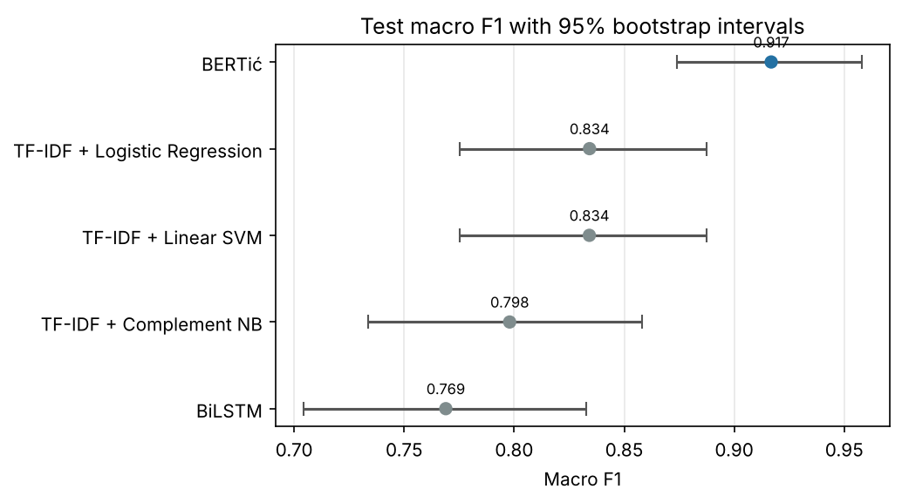

# Serbian Review Sentiment: Classical ML vs. BiLSTM vs. BERTić

[](https://github.com/aleksbrstina/serbian-sentiment/actions/workflows/tests.yml)
[](https://huggingface.co/aleksbrstina/bertic-serbmr-sentiment)
[](https://huggingface.co/spaces/aleksbrstina/serbian-sentiment-demo)

Binary sentiment classification of Serbian movie reviews, comparing three approaches of increasing complexity on **the same data, split, metrics and hardware**:

1. **Classical ML**: TF-IDF over word and character n-grams with logistic regression, linear SVM and Naive Bayes, tuned with Optuna
2. **Neural network from scratch**: a BiLSTM over fastText embeddings with a hand-written PyTorch training loop
3. **Fine-tuned transformer**: [BERTić](https://huggingface.co/classla/bcms-bertic), an ELECTRA model pretrained on Bosnian, Croatian, Montenegrin and Serbian

Every number in this repository is produced by code: reports are regenerated by the scripts, never edited by hand.

## The problem

Serbian is a morphologically rich, lower-resource language written in two scripts. The dataset, [SerbMR](https://github.com/vukbatanovic/SerbMR), contains 1,682 long movie reviews (median ~440 words), balanced between positive and negative. That combination makes the task harder than it looks:

- **Morphology**: one lemma appears in many forms (*film, filma, filmu, filmom, …*), so a quarter of the word forms in held-out reviews never appear in training.
- **Length**: almost every review is longer than a standard 256-token transformer input, and the verdict usually comes at the end.
- **Style**: critics argue with irony, weigh pros against cons, and praise other films to condemn this one.

See the [exploratory analysis](reports/eda/eda_report.md) for the numbers behind each point.

## Results

Test set: 169 held-out reviews, never used for any modelling decision. Macro F1 with 95% bootstrap intervals; latency is the median single-review time on the same CPU for every model. Details, paired significance tests and confusion matrices: [`reports/comparison.md`](reports/comparison.md).

<!-- RESULTS:START -->
| Model | Macro F1 [95% CI] | Accuracy | Training time | Inference per example | Model size |
| --- | --- | --- | --- | --- | --- |
| TF-IDF + Logistic Regression | 0.834 [0.775–0.888] | 0.834 | 5 s (CPU) | 4.3 ms | 1.5 MB |
| TF-IDF + Linear SVM | 0.834 [0.775–0.888] | 0.834 | 9 s (CPU) | 6.8 ms | 5.7 MB |
| TF-IDF + Complement NB | 0.798 [0.734–0.858] | 0.799 | 5 s (CPU) | 5.2 ms | 4.5 MB |
| BiLSTM | 0.769 [0.704–0.833] | 0.769 | 2.4 min (CPU) | 3.1 ms | 41.8 MB |
| BERTić | **0.917 [0.874–0.958]** | 0.917 | 55.0 min (CPU) | 99.7 ms | 443.2 MB |
<!-- RESULTS:END -->



### Key findings

- **BERTić is the only model that is reliably better than the rest.** Its lead over TF-IDF is outside the bootstrap noise and confirmed by McNemar's test, while logistic regression and SVM are indistinguishable from each other.
- **Mixed sentiment is where bag-of-words breaks.** Reviews that contain more cue words of the opposite class than of their own are the most common error type for every TF-IDF model; BERTić handles most of them. It also gets most ironic reviews right, which the TF-IDF models almost always miss.
- **The validation set was too small to rank close configurations.** The classical models lost several F1 points between validation and test, as predicted during tuning; this is why the comparison uses intervals rather than point estimates.
- **Truncation matters.** Keeping the start *and* the end of a review clearly beat keeping only the start for the BiLSTM, and long reviews remain its main weakness.
- **There is a cost.** BERTić is more than an order of magnitude slower per review and two orders of magnitude larger than the TF-IDF model (see the table); for a high-throughput setting the classical model is still a defensible choice.

Error analysis with heuristic tags and 40 manually categorized errors: [`reports/comparison.md`](reports/comparison.md#error-analysis-heuristic-tags) and [`notebooks/02_error_analysis.ipynb`](notebooks/02_error_analysis.ipynb). The reasoning behind every design decision is in [`docs/decisions.md`](docs/decisions.md).

## Demo

**Live demo: [huggingface.co/spaces/aleksbrstina/serbian-sentiment-demo](https://huggingface.co/spaces/aleksbrstina/serbian-sentiment-demo).** It runs the TF-IDF + logistic regression model entirely in the browser: the model is exported to JSON (`sentiment.export_static`) and inference is reimplemented in plain JavaScript (`app/static/`), with a test proving it matches scikit-learn. It highlights the words that drove the decision and shows how the model compares with the others. (Hosting a Python Space with all three models requires a paid Hugging Face plan; `python scripts/deploy_space.py --mode gradio` deploys it where that is available.)

The full app shows all three models side by side, with probabilities, response times, the TF-IDF word contributions and BERTić's attention:

```bash
make app   # http://127.0.0.1:7860
```

## Quickstart

Requires [uv](https://docs.astral.sh/uv/), which installs Python 3.11 itself if needed.

```bash
make install-all    # core + dev + PyTorch (CPU) + transformers + gradio
make test           # unit tests
```

### 1. Data

Datasets are not downloaded automatically.

1. Download `SerbMR-2C.csv` from the [SerbMR v1.0 release](https://github.com/vukbatanovic/SerbMR/releases/tag/v1.0) into `data/raw/`.
2. For the BiLSTM, download the fastText vectors [`cc.sr.300.vec.gz`](https://dl.fbaipublicfiles.com/fasttext/vectors-crawl/cc.sr.300.vec.gz) (~1.2 GB) into `data/raw/embeddings/`.
3. Run:

```bash
make prepare-data   # normalize, deduplicate, split 80/10/10 -> data/processed/, reports/data_quality.md
make eda            # reports/eda/
```

### 2. Training

```bash
make train-classical   # Optuna search over TF-IDF + LR / SVM / NB (~4 min on CPU)
make train-bilstm      # BiLSTM (~3 min on CPU)
make train-bertic      # BERTić: use a GPU (see below)
```

**BERTić on a free GPU:** open [`notebooks/colab_train_bertic.ipynb`](notebooks/colab_train_bertic.ipynb) in Google Colab or Kaggle (T4). It installs the package, rebuilds the data and verifies that the split is identical to the committed one, fine-tunes, optionally publishes to the Hugging Face Hub, and packages the reports. Import that run into local MLflow with `python scripts/import_run.py --report-dir reports/bertic`. The model in the results table was trained on a 4-core CPU as an end-to-end check.

The fine-tuned model is published as [`aleksbrstina/bertic-serbmr-sentiment`](https://huggingface.co/aleksbrstina/bertic-serbmr-sentiment). Load it with `TransformerPredictor.load("aleksbrstina/bertic-serbmr-sentiment")`, which applies the same head+tail truncation used in training.

### 3. Evaluation

```bash
make evaluate    # all models on the test set -> reports/comparison.md and the table above
make notebooks   # re-execute the EDA and error-analysis notebooks
make mlflow-ui   # parameters, metrics and artifacts of every run: http://127.0.0.1:5000
```

Every run is configured by a YAML file in `configs/` (saved next to its results) and logged to a local MLflow store. One-off experiments: `python scripts/train.py --config configs/bilstm.yaml --set params.lr=0.002 --run-name exp-x --report-dir /tmp/exp`.

## How it is built

```text
data/raw ──▶ data (normalize, dedupe, split) ──▶ data/processed/*.parquet
                                                    │
                     ┌──────────────────────────────┼──────────────────────────────┐
                     ▼                              ▼                              ▼
            models/classical.py           models/neural/ (BiLSTM)        models/transformer.py
            TF-IDF + LR/SVM/NB            plain PyTorch loop              HF Trainer (BERTić)
                     └──────────────┬───────────────┴──────────────┬───────────────┘
                                    ▼                              ▼
                       predict.Predictor (one interface)     MLflow (every run)
                          │                     │
                          ▼                     ▼
                 evaluation (test set)      app (Gradio demo)
```

All models implement `predict.Predictor` (`predict`, `predict_proba`); evaluation and the demo use nothing else, so adding a model does not touch them.

```text
configs/        YAML configuration per step and model
src/sentiment/
  data/         loading, text normalization, deduplication, stratified split
  eda/          statistics, plots, generated EDA report
  models/       classical.py, neural/ (tokenizer, dataset, model, train), transformer.py
  evaluation/   metrics, error heuristics, comparison report
  predict.py    common Predictor interface and loader
  tracking.py   MLflow helpers
scripts/        CLI entry points (prepare_data, run_eda, train, evaluate, deploy_space, …)
app/app.py      Gradio demo (all three models)
app/static/     in-browser demo (HTML + JavaScript, exported TF-IDF model)
notebooks/      01_eda, 02_error_analysis, colab_train_bertic
reports/        generated reports and figures (tracked)
docs/           decisions.md: rationale for every non-trivial choice
tests/          unit tests (run in CI on every push)
```

## Data and model licenses

| Resource | License | Source |
| --- | --- | --- |
| SerbMR dataset | CC BY-NC-SA 4.0 | Batanović, Nikolić, Milosavljević (2016). *Reliable Baselines for Sentiment Analysis in Resource-Limited Languages: The Serbian Movie Review Dataset.* LREC 2016. [GitHub](https://github.com/vukbatanovic/SerbMR) |
| fastText Serbian vectors (`cc.sr.300`) | CC BY-SA 3.0 | Grave, Bojanowski, Gupta, Joulin, Mikolov (2018). *Learning Word Vectors for 157 Languages.* LREC 2018. [fasttext.cc](https://fasttext.cc/docs/en/crawl-vectors.html) |
| BERTić (`classla/bcms-bertic`) | Apache 2.0 | Ljubešić, Lauc (2021). *BERTić — The Transformer Language Model for Bosnian, Croatian, Montenegrin and Serbian.* BSNLP 2021. [Hugging Face](https://huggingface.co/classla/bcms-bertic) |

Because the training data is licensed CC BY-NC-SA, the trained models and the demo are for non-commercial research use. Review excerpts quoted in the error analysis come from SerbMR and are shared under the same license.
