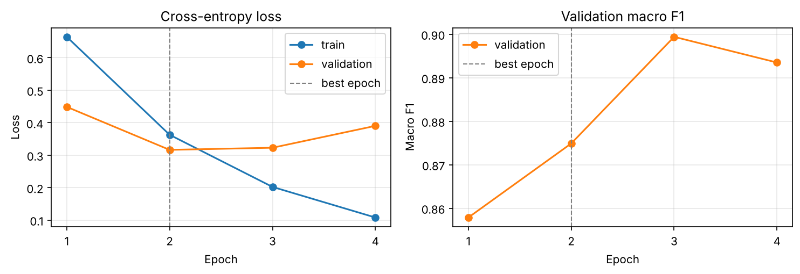

# BERTić: fine-tuning report

_Generated by `scripts/train.py --config configs/bertic.yaml` — do not edit by hand._

## Result

| Metric | Value |
| --- | --- |
| Base model | `classla/bcms-bertic` |
| Validation macro F1 (best epoch) | 0.8749 |
| Validation accuracy | 0.8757 |
| Best epoch / epochs run | 2 / 4 |
| Max length / truncation | 256 / head_tail |
| Training time | 3298.8 s on cpu |
| Inference | 101.48 ms/example (batch), 113.9 ms single text (cpu) |
| Parameters | 110,618,882 |
| Model size on disk | 443.2 MB |
| Reviews truncated at 256 tokens (train) | 97.8% |
| Hugging Face Hub | not published |

## Learning curves

| epoch | val_loss | val_macro_f1 | val_accuracy | train_loss |
| --- | --- | --- | --- | --- |
| 1 | 0.4486 | 0.8579 | 0.8580 | 0.6644 |
| 2 | 0.3162 | 0.8749 | 0.8757 | 0.3626 |
| 3 | 0.3227 | 0.8994 | 0.8994 | 0.2020 |
| 4 | 0.3901 | 0.8935 | 0.8935 | 0.1077 |
