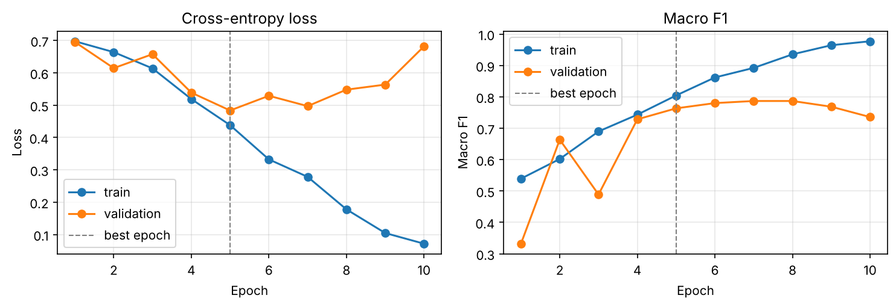

# BiLSTM: training report

_Generated by `scripts/train.py --config configs/bilstm.yaml` — do not edit by hand._

## Result

| Metric | Value |
| --- | --- |
| Validation macro F1 (best epoch) | 0.7632 |
| Validation accuracy | 0.7633 |
| Best epoch / epochs run | 5 / 10 |
| Early stopping triggered | True |
| Training time | 144.5 s |
| Inference | 1.30 ms/example (batch), 3.3 ms single text |
| Parameters (trainable / total) | 187,906 / 10,441,606 |
| Model size on disk | 41.8 MB |

## Vocabulary and embeddings

| Metric | Value |
| --- | --- |
| Vocabulary size (incl. `<pad>`, `<unk>`) | 34,179 |
| Vocabulary types with a fastText vector | 32,534 (95.2%) |
| Validation tokens in vocabulary | 88.1% |
| Validation tokens with a fastText vector | 87.8% |

## Learning curves

| epoch | train_loss | val_loss | train_macro_f1 | val_macro_f1 | val_accuracy | lr | best_so_far |
| --- | --- | --- | --- | --- | --- | --- | --- |
| 1 | 0.6977 | 0.6953 | 0.5391 | 0.3320 | 0.4970 | 0.0020 | ✓ |
| 2 | 0.6640 | 0.6145 | 0.6019 | 0.6634 | 0.6686 | 0.0020 | ✓ |
| 3 | 0.6138 | 0.6577 | 0.6897 | 0.4887 | 0.5740 | 0.0020 |  |
| 4 | 0.5190 | 0.5389 | 0.7431 | 0.7282 | 0.7337 | 0.0020 | ✓ |
| 5 | 0.4382 | 0.4836 | 0.8043 | 0.7632 | 0.7633 | 0.0020 | ✓ |
| 6 | 0.3323 | 0.5291 | 0.8616 | 0.7800 | 0.7811 | 0.0020 |  |
| 7 | 0.2783 | 0.4970 | 0.8921 | 0.7866 | 0.7870 | 0.0020 |  |
| 8 | 0.1777 | 0.5480 | 0.9353 | 0.7866 | 0.7870 | 0.0010 |  |
| 9 | 0.1045 | 0.5636 | 0.9643 | 0.7684 | 0.7692 | 0.0010 |  |
| 10 | 0.0716 | 0.6820 | 0.9769 | 0.7356 | 0.7396 | 0.0005 |  |
