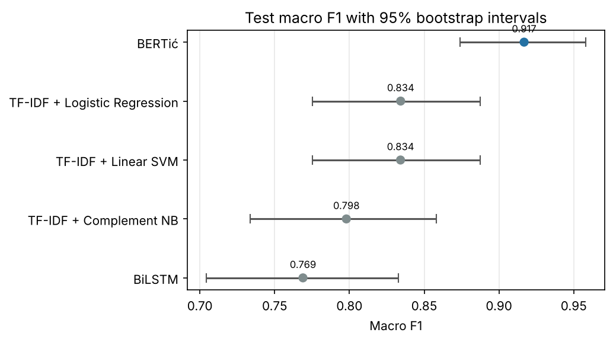
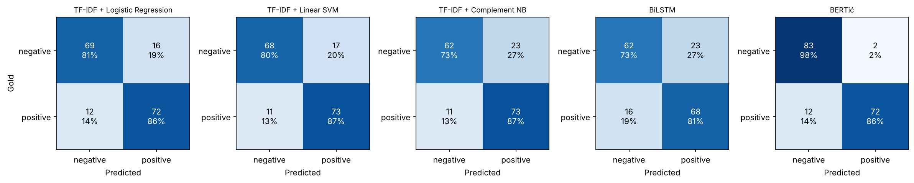
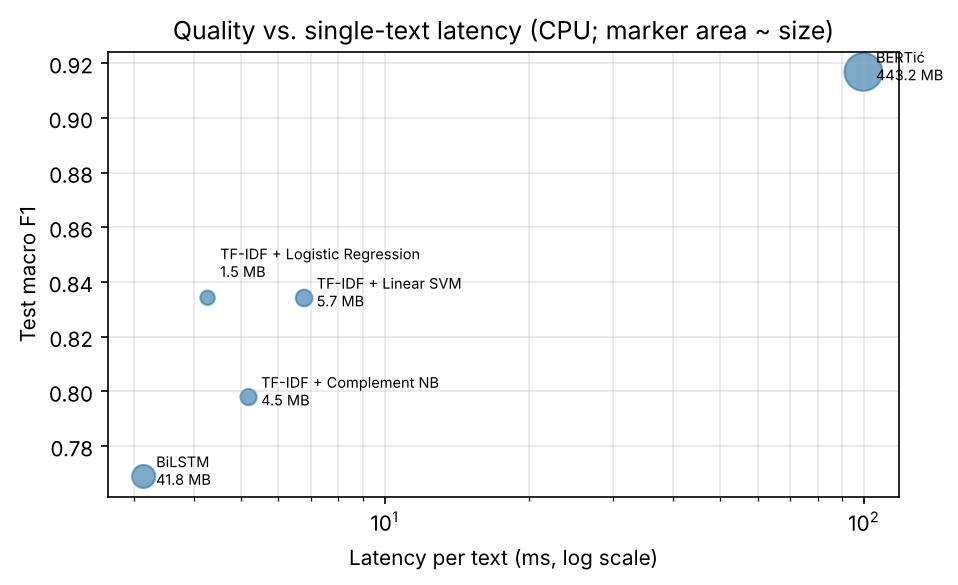
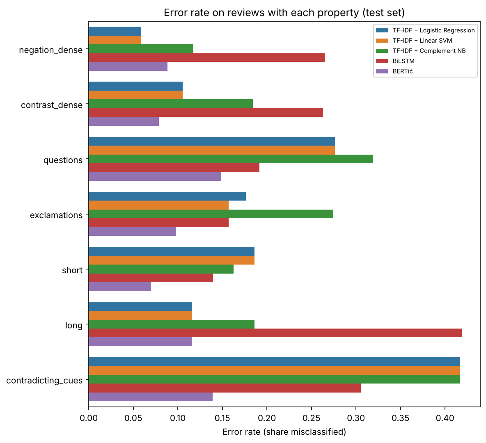

# Model comparison on the test set

_Generated by `scripts/evaluate.py` — do not edit by hand._

All models are evaluated on the same 169 held-out test reviews, loaded through the common `Predictor` interface, with the same metric code. Latency is measured on the same CPU for every model (median of single-text calls). Intervals are 95% percentile bootstrap intervals from 2,000 resamples of the test set, shared by all models (paired).

## Results

| Model | Macro F1 [95% CI] | Accuracy | Training time | Inference per example | Model size |
| --- | --- | --- | --- | --- | --- |
| TF-IDF + Logistic Regression | 0.834 [0.775–0.888] | 0.834 | 5 s (CPU) | 4.3 ms | 1.5 MB |
| TF-IDF + Linear SVM | 0.834 [0.775–0.888] | 0.834 | 9 s (CPU) | 6.8 ms | 5.7 MB |
| TF-IDF + Complement NB | 0.798 [0.734–0.858] | 0.799 | 5 s (CPU) | 5.2 ms | 4.5 MB |
| BiLSTM | 0.769 [0.704–0.833] | 0.769 | 2.4 min (CPU) | 3.1 ms | 41.8 MB |
| BERTić | **0.917 [0.874–0.958]** | 0.917 | 55.0 min (CPU) | 99.7 ms | 443.2 MB |

## Is the best model really better?

Paired comparison against **BERTić**: the bootstrap interval of the difference in macro F1 (same resamples for both models), the share of resamples in which the best model is not ahead, and McNemar's exact test on the reviews where exactly one of the two models is right.

| Compared with | BERTić − model (macro F1) | P(not better) | McNemar p | Only best right / only other right |
| --- | --- | --- | --- | --- |
| TF-IDF + Logistic Regression | +0.083 [+0.015, +0.149] | 0.006 | 0.024 | 24 / 10 |
| TF-IDF + Linear SVM | +0.083 [+0.015, +0.148] | 0.007 | 0.024 | 24 / 10 |
| TF-IDF + Complement NB | +0.119 [+0.047, +0.190] | 0.001 | 0.002 | 30 / 10 |
| BiLSTM | +0.148 [+0.082, +0.216] | 0.000 | 0.000 | 31 / 6 |

## Detailed metrics

| Model | Accuracy | Macro precision | Macro recall | Batch ms/example |
| --- | --- | --- | --- | --- |
| TF-IDF + Logistic Regression | 0.834 | 0.835 | 0.834 | 2.43 |
| TF-IDF + Linear SVM | 0.834 | 0.836 | 0.835 | 2.48 |
| TF-IDF + Complement NB | 0.799 | 0.805 | 0.799 | 2.50 |
| BiLSTM | 0.769 | 0.771 | 0.769 | 1.15 |
| BERTić | 0.917 | 0.923 | 0.917 | 95.69 |

## Error analysis: heuristic tags

Each tag is a measurable property; thresholds are quartiles of the **training** split (negation > 2.07 per 100 words, contrast > 1.17, questions > 0.22, exclamations > 0.18, short ≤ 334 words, long > 552 words). The table shows each model's error rate on test reviews with the tag.

| Tag | Definition | Reviews | TF-IDF + Logistic Regression | TF-IDF + Linear SVM | TF-IDF + Complement NB | BiLSTM | BERTić |
| --- | --- | --- | --- | --- | --- | --- | --- |
| **all reviews** |  | 169 | 17% | 17% | 20% | 23% | 8% |
| `negation_dense` | Negation words per 100 words in the top quartile of training reviews | 34 | 6% | 6% | 12% | 26% | 9% |
| `contrast_dense` | Contrastive markers (ali, međutim, ipak, iako, ...) in the top quartile | 38 | 11% | 11% | 18% | 26% | 8% |
| `questions` | Question marks per 100 words in the top quartile (rhetorical questions) | 47 | 28% | 28% | 32% | 19% | 15% |
| `exclamations` | Exclamation marks per 100 words in the top quartile | 51 | 18% | 16% | 27% | 16% | 10% |
| `short` | Length in the bottom quartile of training reviews | 43 | 19% | 19% | 16% | 14% | 7% |
| `long` | Length in the top quartile of training reviews (most truncated by the models) | 43 | 12% | 12% | 19% | 42% | 12% |
| `contradicting_cues` | More class-indicative words of the opposite class than of its own | 36 | 42% | 42% | 42% | 31% | 14% |

## Error analysis: manual review

40 misclassified test reviews were read and categorized (a review can have several categories). Columns per model count how many of that model's errors fall into each category. Per-review notes: `reports/error_analysis/manual_review.csv`. Reviewer: claude-code (first pass from head+tail excerpts).

| category | description | reviewed | TF-IDF + Logistic Regression | TF-IDF + Linear SVM | TF-IDF + Complement NB | BiLSTM | BERTić |
| --- | --- | --- | --- | --- | --- | --- | --- |
| negation | Sentiment flipped or softened by negation | 10 | 6 | 6 | 7 | 5 | 3 |
| irony | Irony or sarcasm; literal wording opposite to the verdict | 9 | 7 | 8 | 9 | 5 | 1 |
| slang | Slang, informal or colloquial wording | 8 | 7 | 7 | 6 | 5 | 2 |
| mixed_sentiment | Weighs strong pros and cons; verdict hinges on the balance | 21 | 15 | 16 | 15 | 14 | 5 |
| short_text | Too little text to judge | 0 | 0 | 0 | 0 | 0 | 0 |
| plot_summary | Mostly plot retelling; evaluative language is sparse | 6 | 4 | 4 | 3 | 4 | 2 |
| verdict_truncated | Verdict sits in the middle of a long review, outside what the models see | 1 | 0 | 0 | 1 | 1 | 0 |
| rare_vocabulary | Verdict phrased in rare, elaborate or academic vocabulary | 5 | 2 | 2 | 3 | 4 | 2 |
| label_ambiguous | Reasonable readers could disagree with the gold label | 5 | 4 | 4 | 4 | 3 | 2 |
