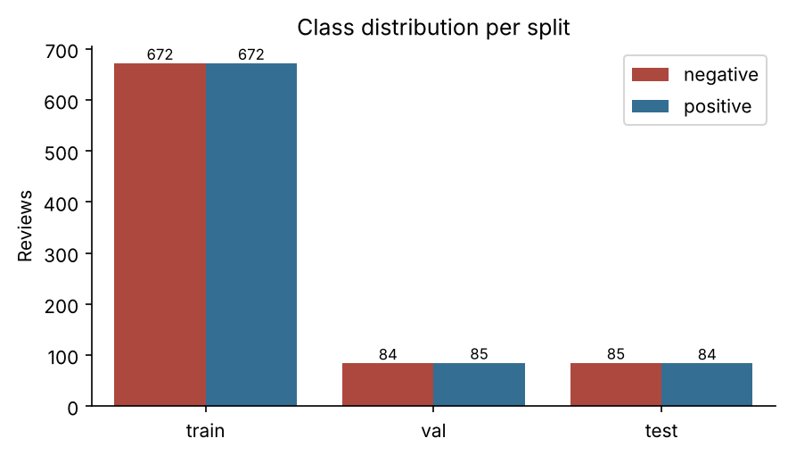
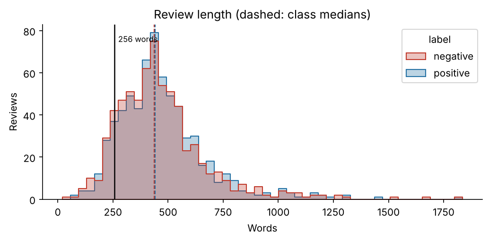
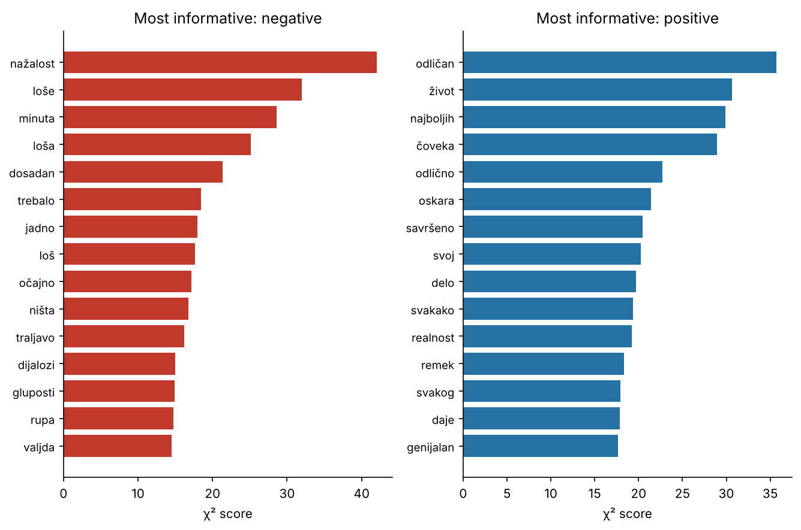
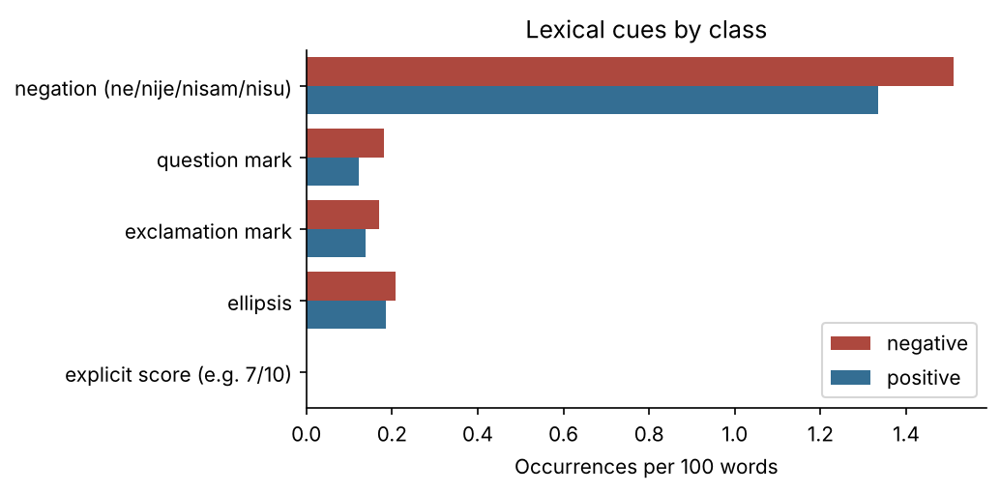

# Exploratory data analysis

_Generated by `scripts/run_eda.py` — do not edit by hand. Word-level statistics use the training split only._

## Key insights

1. **Classes are balanced** (negative 50.0%, positive 50.0% of 1682 reviews), and the stratified split preserves this in every split. Accuracy and macro F1 will therefore tell the same story, and no class re-weighting is needed.
2. **Review length carries no sentiment signal.** Median length is 437 (negative) vs. 442 (positive) words; a Mann-Whitney U test finds no significant difference (p = 0.34). Models cannot shortcut through length and must rely on content.
3. **Reviews are long, so transformer truncation matters.** The median review has ~439 words, and 89.7% exceed 256 words (33.0% exceed 512). Subword tokenization only increases the token count, so a 256-token model sees just the opening part of nearly every review. Head+tail truncation or chunking should be evaluated for BERTić.
4. **Rich morphology produces a long-tailed vocabulary.** The training split has 76,631 distinct word forms in 630,998 tokens; 55.4% of them occur only once. 27.4% of word types (7.8% of tokens) in the validation split never appear in training. One lemma alone appears in many forms (*film* 4308, *filma* 2422, *filmu* 1247, *filmom* 189, *filmovi* 221, *filmova* 561, *filmove* 217, *filmovima* 225). This motivates character n-grams for TF-IDF and subword-aware fastText embeddings for the BiLSTM.
5. **A few evaluative words are strongly class-specific** (top χ² words, share of reviews containing them): negative: *nažalost* (18.0% of negative vs. 5.8% of other reviews), *loše* (16.2% of negative vs. 6.0% of other reviews), *minuta* (25.1% of negative vs. 12.5% of other reviews); positive: *odličan* (14.0% of positive vs. 4.2% of other reviews), *život* (30.1% of positive vs. 15.6% of other reviews), *najboljih* (10.3% of positive vs. 2.7% of other reviews). Even the strongest cues occur in a minority of reviews, so no single keyword solves the task.
6. **Negation and rhetorical questions lean negative, but are everywhere.** Negation words occur 1.51 times per 100 words in negative vs. 1.33 in positive reviews (×1.13), and appear in 97.9% of positive reviews. Question marks are ×1.48 as frequent in negative reviews. Unigram features cannot tell *dobar* from *nije dobar*, and bigrams only catch negation next to the word it modifies, so negation is expected to be a major error category for the classical models. Explicit scores such as "7/10" appear in at most 0.4% of reviews per class, so label leakage through ratings is negligible.

## Class distribution

| split | negative | positive | total |
| --- | --- | --- | --- |
| train | 672 | 672 | 1344 |
| val | 84 | 85 | 169 |
| test | 85 | 84 | 169 |

## Review length (training split, words)

| label | count | mean | median | min | max |
| --- | --- | --- | --- | --- | --- |
| negative | 672 | 466.3 | 437.0 | 21.0 | 1835.0 |
| positive | 672 | 472.0 | 442.0 | 60.0 | 1813.0 |

Mann-Whitney U test for a length difference between classes: p = 0.340.

| Max words | Reviews longer |
| --- | --- |
| 128 | 99.0% |
| 256 | 89.7% |
| 512 | 33.0% |

## Vocabulary

| Metric | Value |
| --- | --- |
| Tokens (train) | 630,998 |
| Word types (train) | 76,631 |
| Hapax share (train) | 55.4% |
| OOV token rate (val) | 7.8% |
| OOV type rate (val) | 27.4% |

## Most informative words (χ² on word presence)

| label | word | chi2 | p_value | doc_share_negative | doc_share_positive |
| --- | --- | --- | --- | --- | --- |
| negative | nažalost | 42.0 | 9.0e-11 | 18.0% | 5.8% |
| negative | loše | 32.0 | 1.6e-08 | 16.2% | 6.0% |
| negative | minuta | 28.6 | 9.1e-08 | 25.1% | 12.5% |
| negative | loša | 25.1 | 5.4e-07 | 6.0% | 0.9% |
| negative | dosadan | 21.4 | 3.8e-06 | 5.7% | 1.0% |
| negative | trebalo | 18.4 | 1.7e-05 | 21.9% | 12.2% |
| negative | jadno | 18.0 | 2.2e-05 | 2.7% | 0.0% |
| negative | loš | 17.6 | 2.7e-05 | 8.9% | 3.3% |
| negative | očajno | 17.2 | 3.4e-05 | 3.0% | 0.1% |
| negative | ništa | 16.8 | 4.2e-05 | 35.1% | 23.1% |
| negative | traljavo | 16.2 | 5.7e-05 | 2.8% | 0.1% |
| negative | dijalozi | 15.0 | 1.1e-04 | 6.7% | 2.2% |
| negative | gluposti | 14.9 | 1.1e-04 | 5.7% | 1.6% |
| negative | rupa | 14.7 | 1.2e-04 | 3.0% | 0.3% |
| negative | valjda | 14.5 | 1.4e-04 | 6.8% | 2.4% |
| negative | glumi | 14.2 | 1.7e-04 | 14.0% | 7.3% |
| negative | pokušaj | 14.2 | 1.7e-04 | 10.4% | 4.8% |
| negative | romantične | 13.8 | 2.1e-04 | 2.8% | 0.3% |
| negative | bilo | 13.7 | 2.1e-04 | 46.6% | 33.8% |
| negative | bar | 13.4 | 2.6e-04 | 10.9% | 5.2% |
| positive | odličan | 35.7 | 2.3e-09 | 4.2% | 14.0% |
| positive | život | 30.6 | 3.1e-08 | 15.6% | 30.1% |
| positive | najboljih | 29.9 | 4.6e-08 | 2.7% | 10.3% |
| positive | čoveka | 29.0 | 7.4e-08 | 6.5% | 16.5% |
| positive | odlično | 22.7 | 1.9e-06 | 6.1% | 14.4% |
| positive | oskara | 21.4 | 3.7e-06 | 2.4% | 8.2% |
| positive | savršeno | 20.4 | 6.2e-06 | 2.2% | 7.7% |
| positive | svoj | 20.3 | 6.8e-06 | 17.6% | 29.5% |
| positive | delo | 19.7 | 9.0e-06 | 7.0% | 15.0% |
| positive | svakako | 19.4 | 1.1e-05 | 9.4% | 18.3% |
| positive | realnost | 19.2 | 1.2e-05 | 0.4% | 4.0% |
| positive | remek | 18.3 | 1.9e-05 | 3.3% | 9.1% |
| positive | svakog | 18.0 | 2.3e-05 | 4.5% | 10.9% |
| positive | daje | 17.9 | 2.3e-05 | 7.7% | 15.6% |
| positive | genijalan | 17.6 | 2.7e-05 | 0.3% | 3.4% |
| positive | majstorski | 16.0 | 6.3e-05 | 0.0% | 2.4% |
| positive | oslikava | 15.2 | 9.6e-05 | 0.6% | 3.7% |
| positive | šire | 14.7 | 1.2e-04 | 0.3% | 3.0% |
| positive | samog | 14.2 | 1.6e-04 | 9.8% | 17.4% |
| positive | svom | 14.0 | 1.8e-04 | 11.5% | 19.5% |

## Most frequent words (stopwords removed)

| negative | positive |
| --- | --- |
| su (2393) | su (2214) |
| iz (1114) | iz (1063) |
| ako (671) | on (736) |
| više (651) | više (639) |
| ima (627) | ima (582) |
| on (611) | ako (527) |
| priča (485) | može (523) |
| može (467) | iako (502) |
| ovog (449) | priča (492) |
| nema (420) | ovog (434) |
| the (413) | the (421) |
| toliko (390) | možda (409) |
| iako (383) | bez (396) |
| bez (382) | način (366) |
| baš (377) | stvari (361) |
| možda (372) | nema (359) |
| ništa (346) | baš (350) |
| malo (341) | treba (341) |
| treba (340) | ljudi (340) |
| stvari (327) | mnogo (339) |

## Lexical cues (occurrences per 100 words; share of reviews containing the cue)

| cue | per100_negative | docs_negative | per100_positive | docs_positive | ratio |
| --- | --- | --- | --- | --- | --- |
| negation (ne/nije/nisam/nisu) | 1.512 | 0.984 | 1.334 | 0.979 | 1.133 |
| question mark | 0.180 | 0.400 | 0.121 | 0.307 | 1.485 |
| exclamation mark | 0.170 | 0.314 | 0.139 | 0.259 | 1.222 |
| ellipsis | 0.209 | 0.440 | 0.185 | 0.418 | 1.131 |
| explicit score (e.g. 7/10) | 0.001 | 0.004 | 0.000 | 0.000 | nan |

